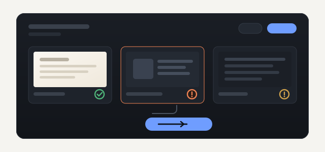

# Proof Board

> Deliverables should not be buried in a chat log. Put them on a board, mark what to fix, hand the notes back to the agent.



A plugin + skill pack for [DeepSeek Harness](https://github.com/deepseek-ai/deepseek-harness) (DSH).

---

## The problem

One session produces three decks, two documents and a pile of images. Then:

- the artifacts live in the transcript — scrolling back to check page 4 is painful;
- review comments like "the title on page 3 overlaps the photo" are written in chat and forgotten by the next round;
- you ask the agent to check its own work, it says "all done", and you have no idea what it looked at.

Proof Board closes the loop: **produce → put it on the board → you annotate → hand it back → produce again**.

Deliverables in a workspace line up as cards, newest first:

- `.pptx` / `.docx` / `.xlsx` — first page rendered through DSH's `officeKit`;
- `.html` decks — live iframe, you can flip through them on the board;
- `.pdf` — native browser preview;
- images — shown as themselves;
- `.md` / `.txt` — first lines as a snippet.

Each card takes **good / fix / TBD** plus one line of notes. Two footer actions:

- **Write checkout list** — writes `审阅清单-<time>.md` into the workspace root, fix items first;
- **Send notes to agent** — composes a prompt and drops it into a new session's composer (draft only, nothing is sent).

## Install

In DSH: **Plugins → Add plugin**, pick this directory. Or:

```text
plugin_manager action: install_bundle target: <absolute path to this repo>
```

Restart DSH; a "Proof Board" entry appears in the sidebar.

## Use

### Human

1. Open **Proof Board** in the sidebar.
2. Read the cards, press `good` / `fix` / `TBD`, write one line: "page 4: title and the three figures use different gaps".
3. **Send notes to agent** — the composer of a new session is pre-filled with the list.

Clicking a card opens the original file in a new tab.

### Agent

| Tool | Purpose |
| --- | --- |
| `proof_board_scan` | List deliverables (newest first) with their notes; filter by `kinds` or `withNotes: "open"` |
| `proof_board_note` | Write a note: `verdict` (ok / fix / todo / clear) plus one-line `text` |
| `proof_board_handoff` | Write the notes as a Markdown checkout list into the workspace root and return its path |

## Skills

- **`proof-board`** — how to use the board: when to scan, how to phrase a note, how to consume the checkout list, what not to do.
- **`deliverable-review`** — a QA checklist per artifact type (deck / doc / sheet / image / page) and how to turn a finding into an actionable note.

## Where data lives

| Data | Location |
| --- | --- |
| Notes | `$DSH_HOME/proof-board/notes.json` (`~/.dsh/proof-board/notes.json` by default), grouped by workspace path |
| Office thumbnails | `$DSH_HOME/proof-board/thumbs/`, invalidated by `mtime + size` |
| Checkout list | `审阅清单-<time>.md` in the workspace root |

Only paths and notes are stored — **your files are never copied**. Removing the plugin leaves this data in place.

## Boundaries

- Files are read from the local workspace only; paths are checked against traversal, hidden files and escaping symlinks.
- The page is served by DSH's own web server and is same-origin with DSH; HTML deliverables render in a sandboxed iframe.
- Notes and thumbnails stay on the machine: no network calls, no telemetry.
- Office thumbnails need DSH's `officeKit` (bundled with the web/desktop builds). Without it, `.pptx/.docx/.xlsx` fall back to plain file cards; everything else keeps working.
- The board sorts by `mtime` — do not `touch` files to reorder it.

## Layout

```text
index.js           entry (re-exports lib/index.js)
lib/index.js       host half: routes, tools, skill provider
lib/board.js       scan / notes / checkout list (pure, unit-tested)
lib/thumbs.js      officeKit thumbnails + cache
lib/tools.js       the three tool definitions
lib/skills.js      skill provider
client.js          browser half: sidebar entry + main panel
web/               the board page (plain DOM, no build)
skills/            the two skills
locale/            English and Chinese titles and descriptions
docs/              plugin detail image
test/              node --test
```

## Develop

```bash
node --test test/*.test.mjs   # no dependencies needed
```

## License

[MIT](LICENSE)