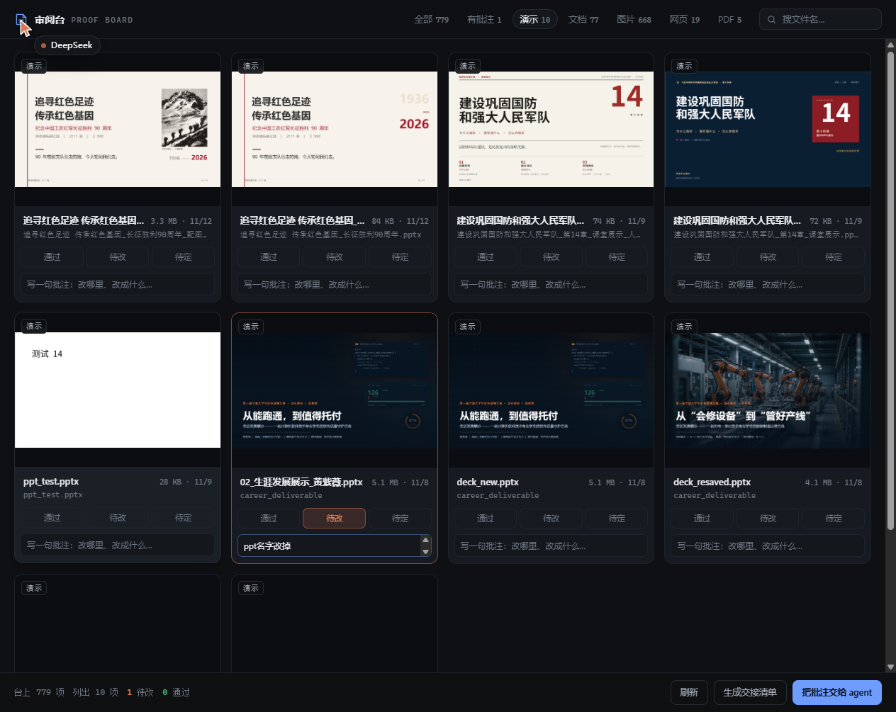

# 审阅台 · Proof Board

<p align="center">
  
</p>

<p align="center">
  <a href="https://github.com/8zvd6qgcsy-creator/dsh-proof-board/actions/workflows/ci.yml"></a>
  <a href="https://github.com/8zvd6qgcsy-creator/dsh-proof-board/releases"></a>
  <a href="LICENSE"></a>
  
  
</p>

> 交付物不该埋在对话里。把它们摆上台面，逐项批注，一句话交回给 agent 去改。

给 [DeepSeek Harness](https://github.com/deepseek-ai/deepseek-harness)（DSH）用的插件 + 技能包。

---

## 它解决什么问题

一次会话里做出三份 PPT、两份文档、一堆配图，是很常见的事。问题是：

- 东西散在对话里，翻回去看第 4 页哪里不对，得往上滚十几屏；
- 「第 3 页字压到图上了」这种评审意见写在聊天里，下一轮改的时候没人记得；
- 让 agent 自己检查，它说「都改好了」，你也不知道它到底看没看。

审阅台把这一圈补上：**产出 → 摆上台面 → 你批注 → 交回给 agent 改 → 再摆上来**。

工作区里的演示、文档、表格、图片、网页、PDF 按修改时间排成一墙卡片：

- `.pptx` / `.docx` / `.xlsx` → 借 DSH 的 `officeKit` 渲染第一页当封面；
- `.html` 演示 → 直接 iframe 实时渲染（能翻页的那份，在台上就能翻）；
- `.pdf` → 浏览器原生预览；
- 图片 → 原图铺开；
- `.md` / `.txt` → 开头几行当预览。

每张卡片上可以标 **通过 / 待改 / 待定**，写一句批注。底栏两个按钮：

- **生成交接清单** → 写一份 `审阅清单-时间.md` 到工作区根目录，按待改优先排序；
- **把批注交给 agent** → 整理成一段提示词，塞进新对话的输入框（不直接发送，你还能补两句）。

## 装

DSH 里 **插件（Plugins）→ 添加插件（Add plugin）**，选这个目录。

或者让 agent 装：

```text
plugin_manager action: install_bundle target: <这个仓库的绝对路径>
```

装完重启 DSH，侧栏会多一个「审阅台」。

## 用

### 你（人）

1. 点侧栏「审阅台」；
2. 看卡片，点 `通过` / `待改` / `待定`，写一句「第 4 页标题和三张图间距不一致」；
3. 底栏「把批注交给 agent」→ 新对话的输入框里已经排好了清单，回车发出去。

卡片点一下 = 在新标签打开原文件。

### agent

插件注册三个工具，写在 skill 里教它怎么用：

| 工具 | 干什么 |
| --- | --- |
| `proof_board_scan` | 扫工作区里的交付物，按修改时间倒序，带上已有批注；可选 `kinds`、`withNotes: open` |
| `proof_board_note` | 给一项写批注：`verdict`（ok / fix / todo / clear）+ 一句 `text` |
| `proof_board_handoff` | 把批注整理成 Markdown 交接清单，写进工作区根目录，返回绝对路径 |

## 两个技能

插件通过 `ctx.skills` 提供两个 skill，装好就能被模型调用（也可以在 `/skill` 里点）：

- **`proof-board`** — 审阅台的用法：什么时候扫、批注怎么写、交接清单怎么读、别做哪些事。
- **`deliverable-review`** — 交付物质检清单：PPT / 文档 / 表格 / 图片 / 网页各查什么，问题怎么写成一句能执行的批注。

## 数据在哪

| 内容 | 位置 |
| --- | --- |
| 批注 | `$DSH_HOME/proof-board/notes.json`（默认 `~/.dsh/proof-board/notes.json`），按工作区路径分组 |
| Office 缩略图缓存 | `$DSH_HOME/proof-board/thumbs/`，按 `mtime + 体积` 失效 |
| 交接清单 | 工作区根目录的 `审阅清单-<时间>.md` |

只记路径和批注，**不复制你的交付物**。删掉插件不会删这些数据。

## 边界与隐私

- 文件只从本机工作区读，路径做越界检查（`..`、隐藏文件、逃出去的符号链接一律拒绝）。
- 页面由 DSH 自己的 Web 服务提供，和 DSH 同源；HTML 交付物在 `sandbox` iframe 里渲染。
- 批注、缩略图都不出本机，不联网、不遥测。
- Office 缩略图依赖 DSH 的 `officeKit`（web/desktop 版本自带）。没有它，`.pptx/.docx/.xlsx` 退化成文件卡片，其余功能不受影响。
- 台面按 `mtime` 排序，所以**不要**为了排序去 `touch` 文件。

## 目录

```text
index.js           入口（转出 lib/index.js）
lib/index.js       Host 半边：路由 + 工具 + skill 注册
lib/board.js       扫描 / 批注 / 交接清单（纯函数，可单测）
lib/thumbs.js      officeKit 缩略图 + 缓存
lib/tools.js       三个工具的定义
lib/skills.js      skill 提供方
client.js          浏览器半边：侧栏入口 + 主区面板
web/               台面页面（原生 DOM，无构建）
skills/            两个 skill
locale/            中英文标题和描述
docs/              插件详情图
test/              node --test
CHANGELOG.md       版本记录（Keep a Changelog 格式）
```

## 开发

```bash
node --test test/*.test.mjs   # 不需要装依赖
```

## 许可

[MIT](LICENSE)